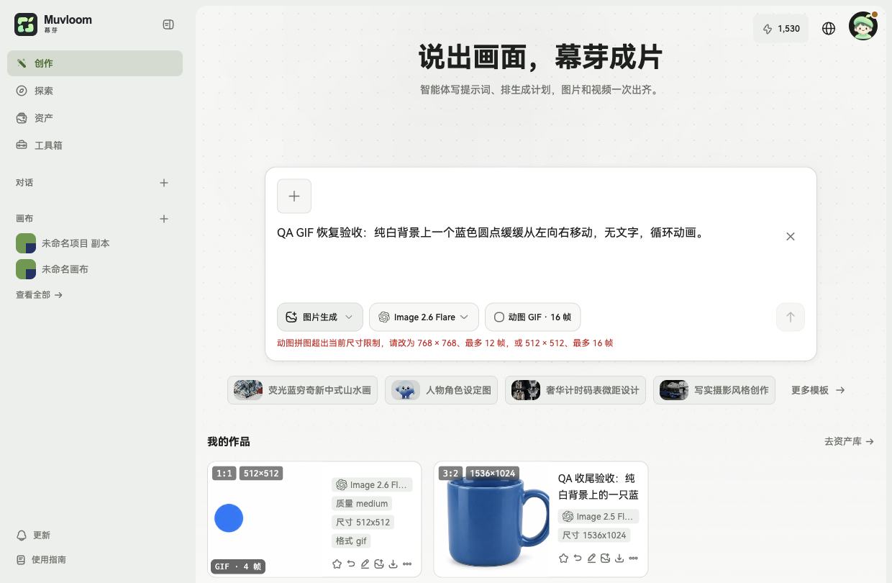
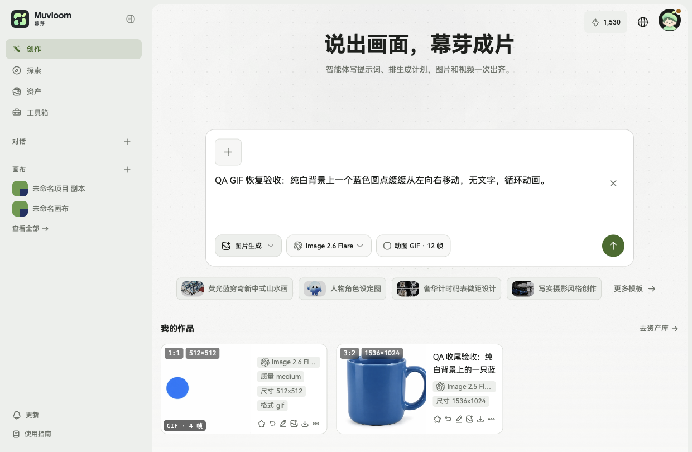
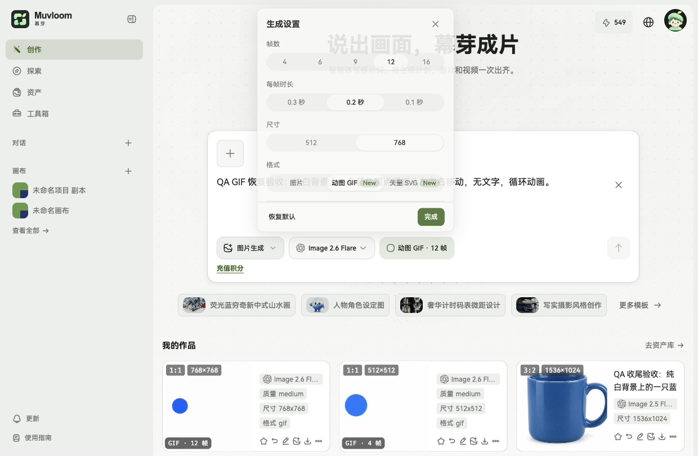
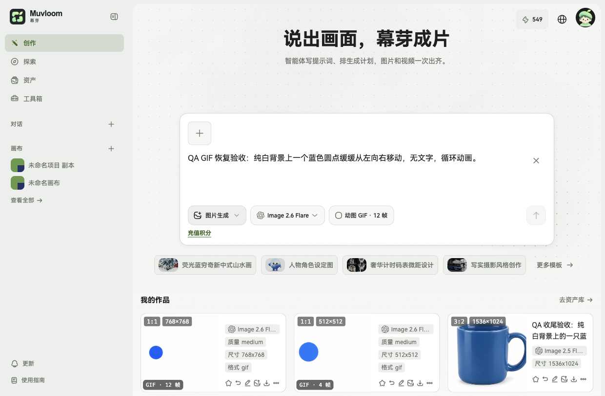

# GIF 拼图校验与 MIME 修复验收

- 环境：https://test.muvloom.online/image（独立测试数据库与存储）。
- 账号类型：已登录 QA 邮箱测试账号，非生产用户。
- 日期：2026-11-05。
- 代码提交：`3a1e590988d3268a7f7cf5079fb92c4ecd875b0e`。
- 测试部署提交：`bf188927c13450588e6a05f3d1fb45dd3c470d13`。
- Overlay：`2ebae77d3429cb166dd45e1890a791fccd4d8850`。
- 前端版本：`bf18892+2ebae77-20261105T135224Z`；API `/health` 同版本且 `ok=true`。
- [云端完整检查](https://github.com/Muluk-m/ai-image-playground/actions/runs/42037364864)与[测试部署](https://github.com/Muluk-m/ai-image-playground/actions/runs/42038088593)均成功。最终格式化 patch 为空；lint、typecheck、Web/BFF/其余包测试、overlay 检查、构建与浏览器启动冒烟通过。

## 实测

1. Image 2.6 Flare，GIF `768×768、16 帧`：出现「动图拼图超出当前尺寸限制，请改为 768 × 768、最多 12 帧，或 512 × 512、最多 16 帧」；生成按钮 `disabled=true`。未提交该超限配置。
2. 改为 `768×768、12 帧`：提示消失，生成按钮恢复可用。
3. 通过真实 UI 提交一次 `768×768、12 帧、200ms、medium` GIF，兼容渠道 `/v1/queue/openai-compat/gpt-image-2.6-flare/submit` 返回 HTTP 200。任务 `f4dfd1f6-dbdb-47ea-9f4e-eb3a4bd08c50` 完成，页面显示 GIF 12 帧。
4. 读取该任务的授权媒体响应：HTTP 200、`Content-Type: image/gif`、文件头 `GIF89a`、105271 字节。浏览器 ImageDecoder 解码为 12 帧、768×768，首帧时长 200000 微秒。
5. 本次真实测试消耗测试账号 981 积分（1530 → 549），没有生产生成或计费操作。

## 规则与边界

拼图按实际网格计算总像素，包含空白格。产品侧保守预算为 7077888 像素，依据已成功的 `768×768、12 帧` 设置；这不是已确认的上游精确上限。保留原有最长边规则，不自动改参或重试。

MIME 根因在 Admin 读取归档结果时忽略 `mime`、统一标成 PNG。本次保留归档 MIME；缺失或类型不正确时才沿用 PNG 回退。归档本身已有按文件字节识别逻辑，新增真实 GIF 回归证明上游误报 PNG 时，归档 MIME、存储 Content-Type、原始字节和可解码性仍正确。Admin GIF/JPEG/WebP/SVG 路由测试在云端通过；本次没有宣称测试站运行独立 Admin。

## 截图

