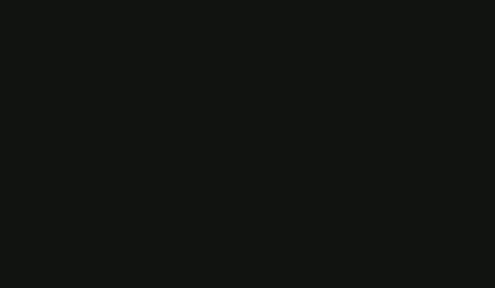
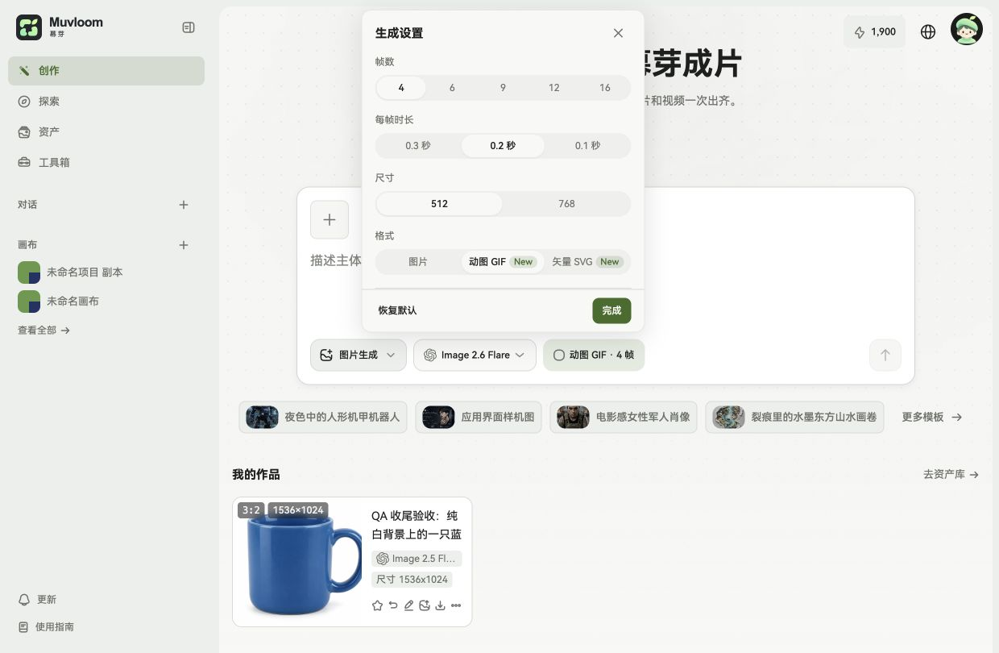
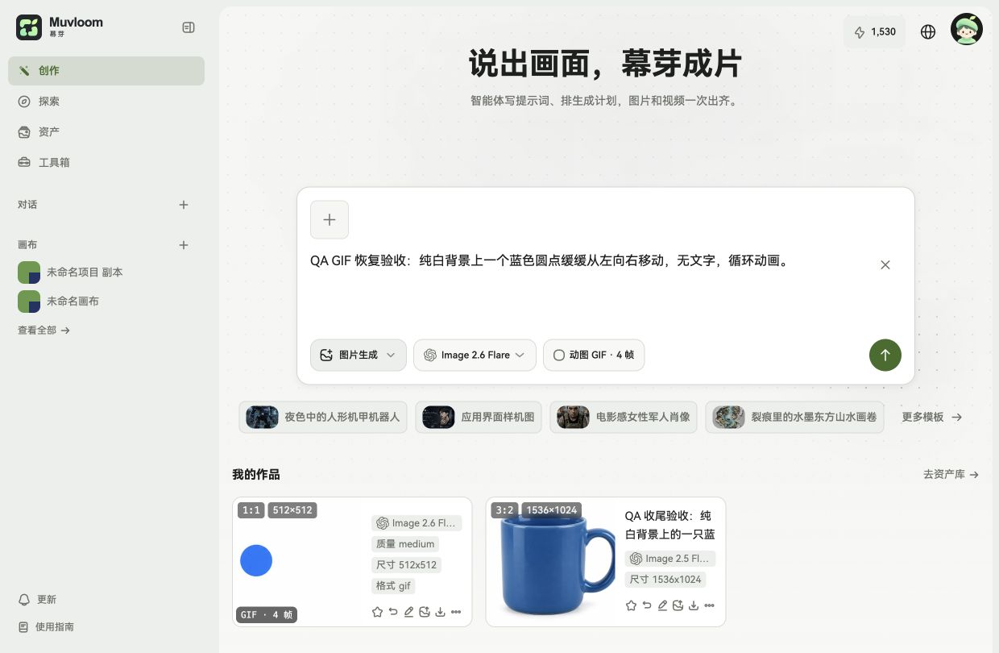

# GIF 格式白屏修复验收

- 故障前端：公开提交 `7acf3105a`，堆栈 `AuthGate-BQBRsvSX.js` 与用户截图一致。
- 复现环境：`https://test.muvloom.online/image`，修复前前端 `b23a612+2ebae77-20261105T112611Z`。
- 复现：匿名用户选择 Image 2.6 Flare → 生成设置 → 动图 GIF，页面白屏并报 React #185；已保存 GIF 设置时刷新也会触发。
- 根因：InputBar 的通用校正把 GIF 的 512/768 帧尺寸按静态图最小像素规则改成 816；ImageSettings 将其改回 768，形成更新循环。AuthGate 是分包名称，不是会话刷新出错的证据。
- 修复：共享参数校正层按模型与输出格式使用 GIF 帧尺寸规则，覆盖输入框、画布与请求分发调用。
- 修复前回归：`5260bb873` 的 Cloud tests #42020757076，3 个真实 InputBar 用例全部因 Maximum update depth exceeded 失败，堆栈同样落在 Radix compose-refs。
- 修复后回归：`c358912f5` 的 Cloud tests #42021031274，470 个文件、4272 个用例通过，14 个跳过；3 个崩溃用例通过。
- 最终源码：`471a4ec42`（仅从云端取回测试格式化补丁），Web checks #42021326405。
- 独立复查：仅提供 diff 与 REVIEW.md，gpt-6-astra / max，无发现，未由复查 Agent 运行测试。
- 测试发布提交：`74ed84fcb3b65032d4127972b4ea9e684b9bc519`，包含源码 `471a4ec42` 与既有测试分支内容。
- 业务验收账号：独立测试环境的 QA 免费账号，无生效套餐；未使用生产账号或生产数据。

## 测试站浏览器验收

- Deploy test #42021381984 成功，前端 `74ed84f+2ebae77-20261105T115508Z`，API `/health` 对应同一组公开/私有提交。
- 原先保存 GIF 后白屏的页面刷新后正常恢复，摘要仍为「动图 GIF · 6 帧」，控制台无新增错误。
- QA 免费账号从静态图片切换 GIF、选择 512 帧尺寸与 4 帧，设置和输入框正常。
- 真实请求：`size=512x512`、`quality=medium`、`output_format=gif`、`frame_count=4`、`frame_duration_ms=200`、`n=1`。
- 任务 `997cbe7c-0427-4d98-af4c-305b438d394b` 返回成功，页面显示「生成完成，共 1 张图片」和 `GIF · 4 帧 / 512×512` 产物。
- 测试积分从 1900 到 1530，实际消耗 370；只运行这一单真实生成。未新增模型调用、定价或额度规则。
- 最终 Web checks #42021326405 全绿；云端格式化补丁为空。根因修复代码之后仅新增本验收文档和截图。

