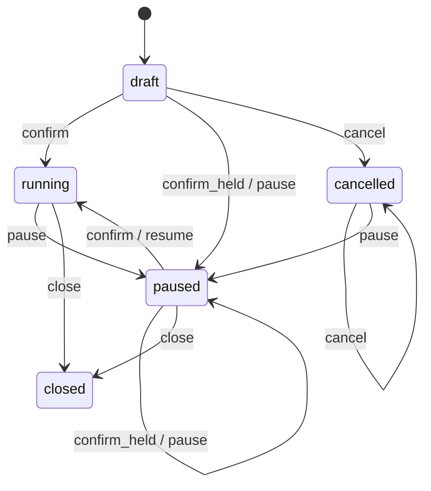

# 智能体批量任务

`agent_batches.status`。转移表：`packages/shared/src/machines/agent-batch.ts`。

`confirm_held` 是确认时计划要求先停住（改价或重新确认）。取消只打在草稿上。删除会话时，除了已关闭的批次，其余都标成 paused，包括已经取消的草稿。已关闭的批次不会因此再被取消或暂停。确认、暂停、恢复、关闭和取消的状态值已经改由这张表给出。
