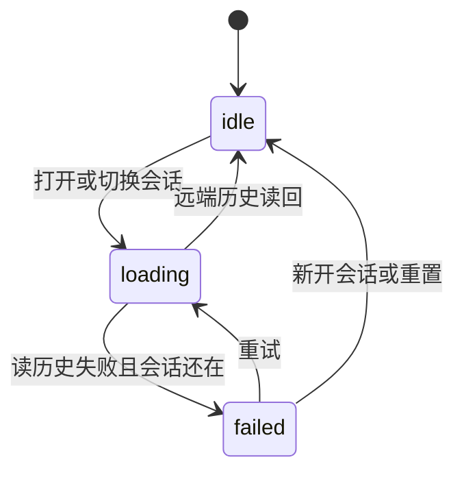

# 智能体历史（面板视图）

store 里的三个字段：`historyCached`、`historyLoading`、`historyFailed`。视图：`apps/web/src/features/agent/lib/historySession.ts`。

加载时可以同时带着一份 IndexedDB 快照（`cached`）。失败时也一样：有快照就提示同步失败，没有就提示加载失败。这两个轴和改视图之前的文案分支一致。

`loading` 优先于 `failed`，避免两个布尔同时为真时出现「既在转圈又在报错」。idle 上残留的 `cached` 视图直接丢掉——远端成功后 store 本来就会清掉它。写入点还散落在 store，收成一个 reducer 留作提案。
