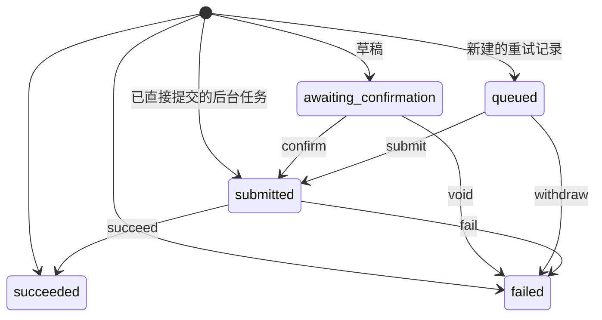

# 智能体工具卡

已落库的 `toolResult.status`。新建一张卡不是转移。转移表：`packages/shared/src/machines/agent-tool.ts`。

失败卡上的「重试」会另插一条记录，不把原卡从 failed 改回 queued。确认、作废、重试提交和后台任务终局已经改用这张表。客户端还有 `running`（流式占位）和投递状态，那是另一台机器，见清单。
