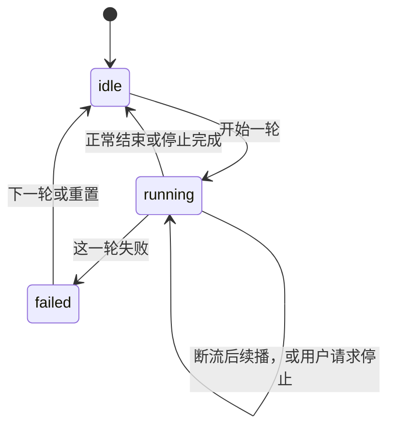

# 智能体对话轮（面板视图）

store 里的三个字段：`turn: idle | running | failed`，加上 `stopping`、`reconnecting`。视图：`apps/web/src/features/agent/lib/turnSession.ts`。

跑着的时候，流是 `live | reconnecting`，停止是 `idle | requested`，两个轴同时成立（停止请求发出时流可能还在重连）。连接提示只在 `running + reconnecting` 时出现，和改视图之前一样。

idle 上残留的 `reconnecting` 视图直接丢掉。store 的写入还散落在二十多处，收成一个 reducer 留作提案，避免这次改面板时序。
