# 智能体对话轮（面板视图）

store 对外仍是三个字段：`turn: idle | running | failed`，加上 `stopping`、`reconnecting`。
合法形状和事件在 `apps/web/src/features/agent/lib/turnSession.ts`。写入走 `applyTurnSessionEvent`。

```mermaid
stateDiagram-v2
  [*] --> idle
  idle --> live: start / ensureRunning
  idle --> failed: fail
  failed --> live: start / ensureRunning
  failed --> idle: finish
  live --> live_stopping: requestStop
  live --> reconnecting: reportReconnect
  live --> idle: finish
  live --> failed: fail
  live_stopping --> live: clearStop
  live_stopping --> reconnecting_stopping: reportReconnect
  live_stopping --> idle: finish
  live_stopping --> failed: fail
  reconnecting --> live: clearReconnect
  reconnecting --> reconnecting_stopping: requestStop
  reconnecting --> idle: finish
  reconnecting --> failed: fail
  reconnecting_stopping --> reconnecting: clearStop
  reconnecting_stopping --> live_stopping: clearReconnect
  reconnecting_stopping --> idle: finish
  reconnecting_stopping --> failed: fail
```

`start` 总会回到 `live`（清空停止和重连）。`ensureRunning` 在已经 running 时保留当前的流和停止标志，只从 idle / failed 进入 `live`。

跑着的时候，流是 `live | reconnecting`，停止是 `idle | requested`，两个轴同时成立。连接提示只在 `running + reconnecting` 时出现，和改写入之前一样。

idle / failed 上的 `requestStop`、`reportReconnect` 是空操作，不会写出 `idle && reconnecting` 这类非法组合。
