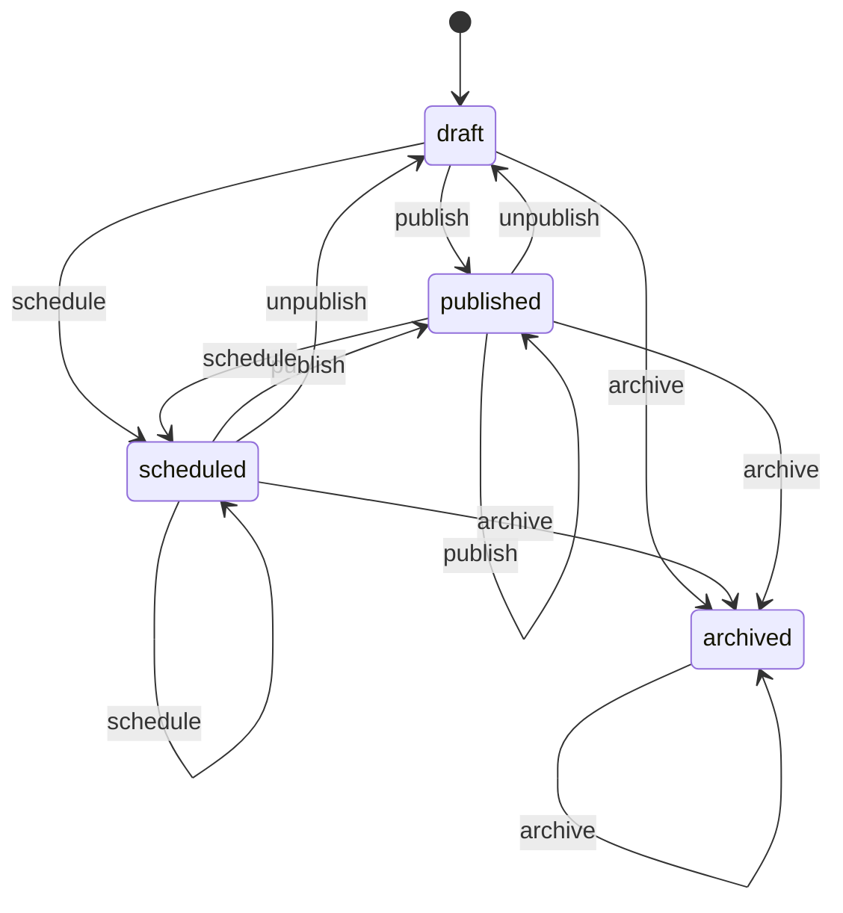

# 公告发布

库存四态。到点是否公开由 `effectiveAnnouncementStatus` 按 `publishAt` / `expireAt` 计算，不改这一列。转移表：`packages/shared/src/machines/announcement.ts`。

`revise` 是自环，只在 draft / scheduled / published 上成立。改正文、发布、撤回、归档都走这张表。已归档不能发布或撤回。发布先看状态，再看窗口是否合法：已归档公告即使窗口不合法也返回 `invalid_announcement`，错误码不变。
