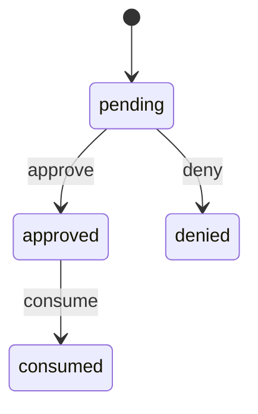

# 设备码授权

`device_authorizations.status`。过期看 `expires_at`，不另设状态。转移表：`packages/shared/src/machines/device-authorization.ts`。

拒绝和已兑换都不能再兑换。已兑换在宽限期内按原请求标识重发同一组令牌，那不是状态转移。

认领、兑换写入已改用 `step`。设备码插入仍是 `pending`。本轮不给兑换更新追加 `status = approved` 的 WHERE，那会改变并发下的最后写入。
