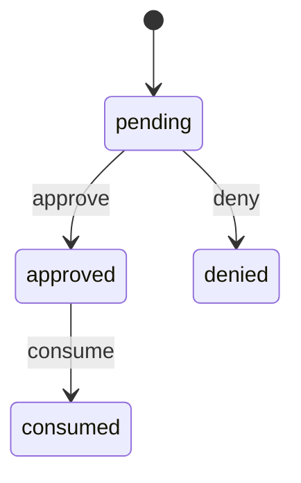

# 设备码授权

`device_authorizations.status`。过期看 `expires_at`，不另设状态。转移表：`packages/shared/src/machines/device-authorization.ts`。

拒绝和已兑换都不能再兑换。已兑换在宽限期内按原请求标识重发同一组令牌，那不是状态转移。

批准、拒绝和兑换写入都用 `step`；兑换更新带 `status = approved` 守卫，并发下只有一次兑换成功。设备码插入仍是 `pending`。
