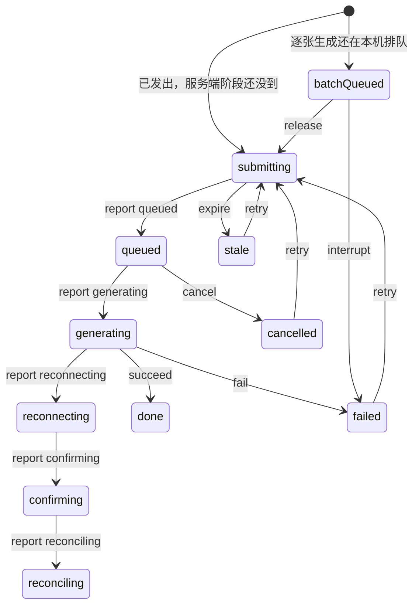

# 工作台与画布的生成阶段

工作台任务行和画布占位框共用 `apps/web/src/lib/generationActivity.ts`。一次只有一个阶段。写入用 `applyGenerationActivity(当前阶段, 事件)`，事件是否合法只看当前阶段。非法事件打一条警告（开发环境）和 Sentry breadcrumb（页面上若有 Sentry），阶段保持不变，界面不抛错。

图里只画了主路径。活着的阶段之间可以按服务端回报互转。完成后的进度、取消后的失败、本机还没发出去就收到的生成中，都留在原阶段。

旧记录没有 `activity`。读的时候把 `status`、`queuePhase`、`cancelled`、`batchQueued` 折成一个阶段：完成后残留的阶段丢掉，已取消但状态仍是进行中的按已取消，本机排队同时带着生成中的按本机排队。
