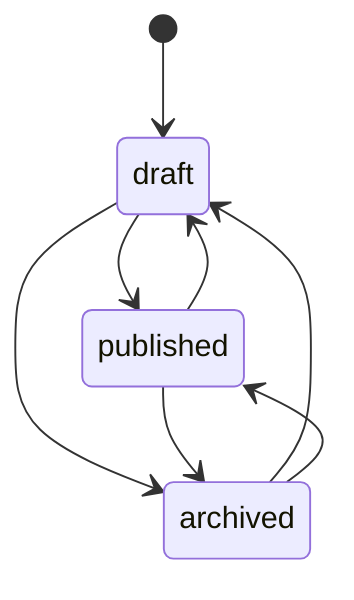

# 灵感库发布

转移表：`packages/shared/src/machines/inspiration.ts`。

现网接口接受三种状态之间的任意设置，包括写回自身。表按这个行为建，没有收紧，否则运营脚本会突然 4xx。

删除不是状态转移。`remove` 只允许 draft 和 archived。published 必须先归档，错误码仍是 `published_item_must_be_archived`。状态写入用 `step`，下一状态与请求的状态相同。
