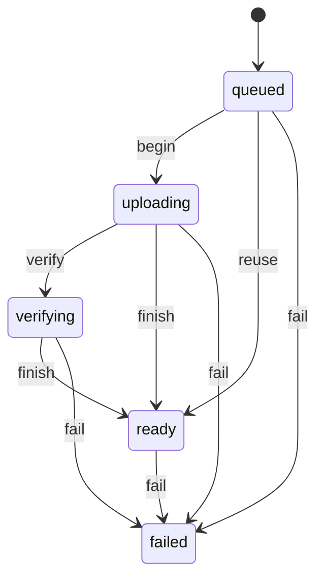

# 参考图上传

浏览器里一张图的上传阶段。转移表：`apps/web/src/lib/mediaUploadMachine.ts`。类型仍是 `apps/web/src/lib/mediaUpload.ts` 的 `MediaUploadState`，两处成员一致，由测试锁住。

`reuse` 是摘要已经传过。`uploading → ready` 是预留接口直接返回 ready、不再确认。`ready → failed` 保留现有 catch：成功之后的计时上报若抛错，仍会把回调打成 failed。这是现行为，不是新的用户可见分支。
