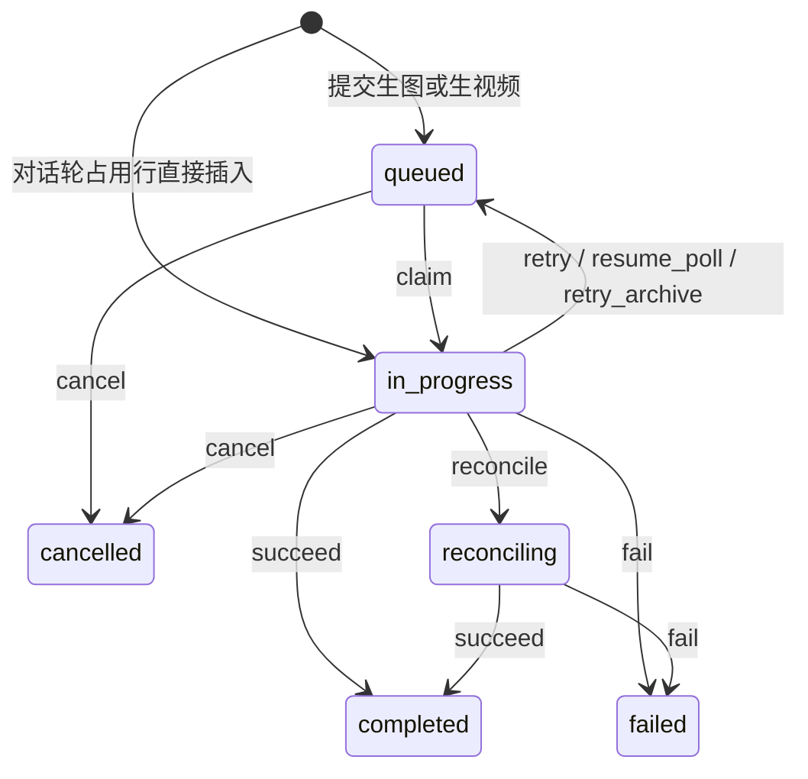
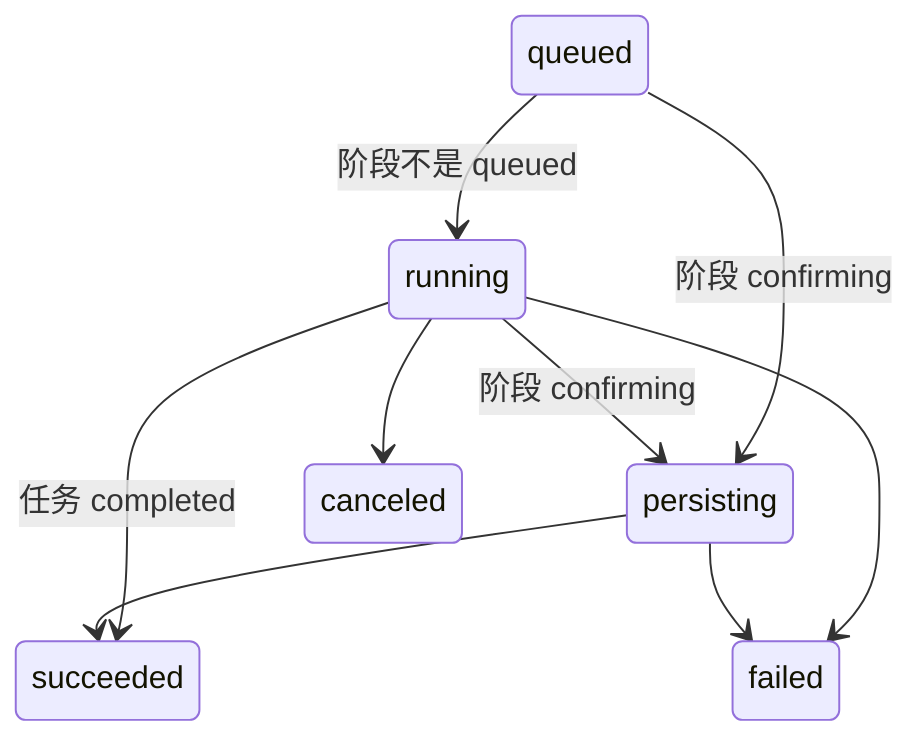

# 队列任务 `tasks.status`

库存状态与 [queue-protocol](../../packages/shared/src/queue-protocol.ts) 的 `TASK_STATUSES` 相同。转移表：`packages/shared/src/machines/queue-task.ts`。

`reconciling` 不能取消、不能直接重试。取消已发出的上游请求时，先进入核查，预扣留在那里。

CLI 不暴露这六态。`projectCliJobStatus` 把 `completed` 映成 `succeeded`，`cancelled` 映成 `canceled`，进度阶段 `confirming` 映成 `persisting`，`reconciling` 仍是 `running`。

结算函数里的写入还没有改成 `step`，见 [INVENTORY](INVENTORY.md) 的提案。认领（`queued → in_progress`）在后续 PR 接到 worker。
