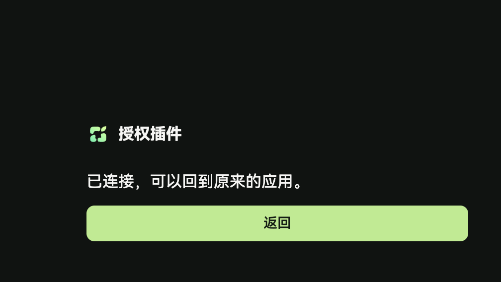
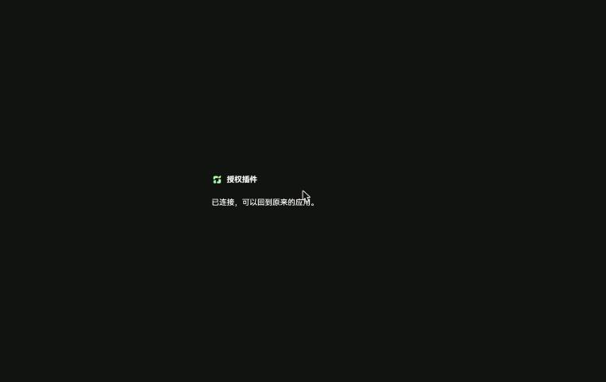

# CLI 本机回调登录：测试环境实测

- 环境：https://test.muvloom.online（测试后端 test-api.muvloom.online），test 分支 @ 44a7bf386，含本分支 ae9cb97e0
- 账号：Nain 的测试账号（网页登录），CLI 为本分支本机编译，凭据存临时目录，实测后已 `auth logout` 吊销
- 命令：`muvloom auth login`（无其他参数）

终端输出（18 秒内结束，未输出授权链接）：

```
Opened the browser to approve this connection (code SJND-FPGZ). Waiting…
Signed in.
{"ok": true, "data": {"state": "ready", ...}}
```

浏览器在授权后跳回本机回调，最终停在确认页的「已连接」状态：



第一次实测（修复前）浏览器停在 `127.0.0.1:<port>/callback` 的 ERR_CONNECTION_REFUSED：设备码轮询抢在页面跳转前拿到令牌，CLI 退出。修复为确认页声明会跳回本机时，授权码有效期内设备码按等待处理（见 ae9cb97e0 之前的两个提交）。

测试环境 test @ 81d14d0b0（含本修复）：已连接状态不再显示返回按钮（CLI 用系统命令打开的标签页脚本关不掉，按钮点了没反应）。


